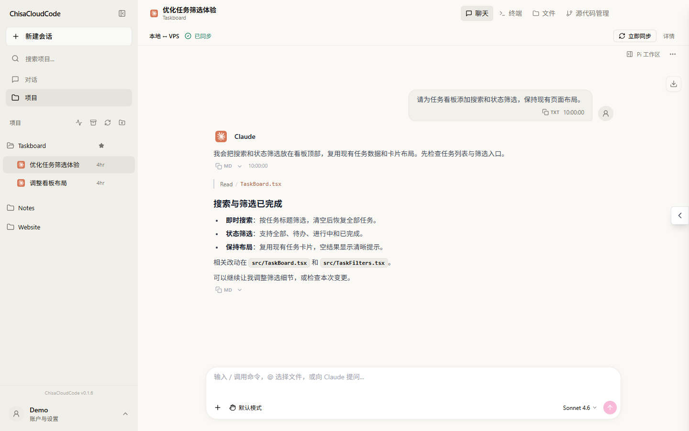

# ChisaCloudCode

在 Windows 桌面使用云端 AI 编程工作区：本地编辑项目，VPS 执行 Claude Code / Codex 任务，完成后将文件同步回本地。



*示例数据演示：项目、会话与路径均为虚构，不包含真实账号或服务器信息。*

## 功能

- **桌面聊天**：支持 Claude Code、Codex，以及 Pi 本地执行模式。
- **项目同步**：连接本地目录与 VPS 工作区，管理同步状态和任务交还。
- **工作区工具**：查看文件、编辑代码、使用终端与应用预览。
- **任务协作**：支持后台任务、消息排队与执行状态查看。

## 使用

1. 按[服务端部署说明](deploy/server/README.md)准备自己的 VPS 服务，并配置所需的模型服务或 CLI 登录。
2. 从 [Releases](https://github.com/ChisaAlter/ChisaCloudCode/releases) 下载 Windows 客户端，或按下文自行构建；填写自己的 **HTTPS 服务地址、用户名和密码** 登录。
3. 选择项目、关联本地目录，等待同步就绪后开始对话。

项目处于 Beta 阶段；Windows 安装包未签名。仓库不提供公共服务器、账号或模型凭据。正式发布的安装包、源码与校验清单位于 Releases；客户端和服务端应使用同一发布版本。

## 构建

需要 Windows、Node.js 24、Go 1.27.1，以及 [MyGo](https://github.com/egoist/mygo) 的 Windows 构建依赖。

先从 Releases 下载 [`runtime-dependencies.json`](runtime-dependencies.json) 对应的定制 Mutagen **0.18.1-chisa.2** 并核对校验值，将 `mutagen.exe` 和 `mutagen-agents.tar.gz` 放到仓库根目录；也可按[同步引擎构建说明](ops/mutagen/README.md)从公开补丁重建。该运行时提供应用需要的忽略规则更新能力，不能用上游原版替代。

```powershell
npm ci --prefix cloudcli-ui
npm ci --prefix app
npm run build --prefix cloudcli-ui       # Web 前端与服务端
npm run build --prefix app               # Windows 客户端与安装包
```

服务端配置见 [`cloudcli-ui/.env.example`](cloudcli-ui/.env.example)，备份与维护见[运维指南](ops/README.md)。真实配置、密钥、账号状态、会话、日志及构建产物应保留在仓库之外。

## 来源与许可

基于 [CloudCLI UI 1.37.3](https://github.com/siteboon/claudecodeui)，桌面壳使用 MyGo，文件同步使用 Mutagen。上游信息见 [`SOURCE.json`](SOURCE.json)。

遵循 **AGPL-3.0-or-later**；上游及插件的许可与署名予以保留，见 [LICENSE](LICENSE) 和 [NOTICE](NOTICE)。

## 致谢

感谢 [Linux.do](https://linux.do) 社区。
